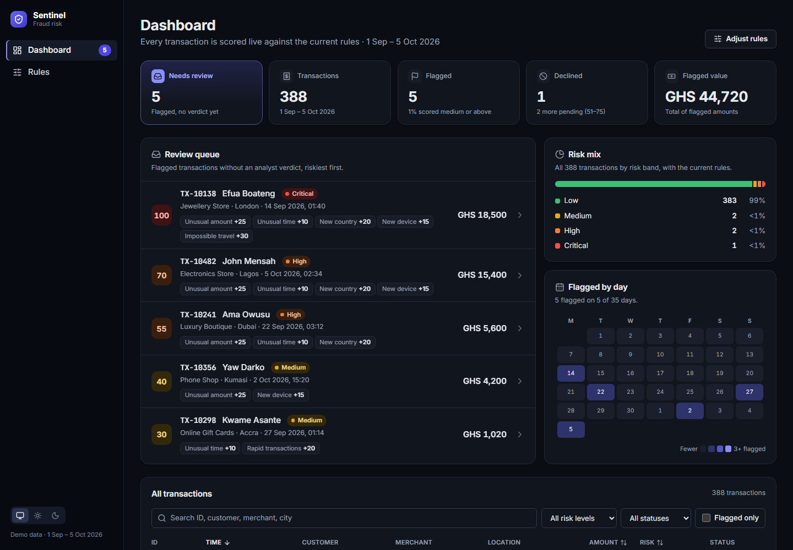

# Sentinel

A fraud-risk dashboard that scores every transaction live against a set of editable rules, and gives analysts a queue of flagged transactions to review.

**Live demo:** https://gid-dadzie.github.io/Sentinel/



> All data is generated. 388 transactions for 10 fictional customers between 1 September and 5 October 2026, with a few suspicious ones planted on purpose. Nothing is sent to a server: rule changes, analyst reviews and the theme choice are saved in your browser.

## What you can do

- **Work the review queue.** The dashboard opens on flagged transactions that have no analyst verdict yet, riskiest first, with the rules that fired on each.
- **Investigate a transaction.** See exactly why it scored what it did, rule by rule, next to the customer's normal behaviour (average amount, known countries and devices) and their recent activity. Record a verdict: confirmed fraud or legitimate.
- **Look at a customer.** Headline numbers, current risk (the average score of their last 5 transactions), flagged transactions, the countries, cities, devices and categories they normally use, and their full history.
- **Tune the rules.** Switch rules on or off and change their points. Every transaction is re-scored immediately, and the page shows how flagged, pending and declined counts change against the defaults.
- **Search, filter and sort** all transactions by risk level, status, country, minimum amount and start date. Filters live in the URL, so a filtered view can be bookmarked or shared.
- Light, dark or system theme. Works on phones.

## How scoring works

Each transaction is checked against six rules, using only that customer's **earlier** transactions as history. The points of every rule that fires are added up and capped at 100.

| Rule               | Fires when                                                                                      | Default points |
| ------------------ | ----------------------------------------------------------------------------------------------- | -------------: |
| Unusual amount     | At least 3 earlier transactions and the amount is above 5× the customer's average               |             25 |
| Unusual time       | Made between 00:00 and 04:59                                                                    |             10 |
| New country        | The customer has history but has never transacted in this country                               |             20 |
| New device         | The customer has history but has never used this device                                         |             15 |
| Rapid transactions | 4 or more transactions (including this one) within 5 minutes                                    |             20 |
| Impossible travel  | City differs from the previous transaction, over 200 km away, at an implied speed over 900 km/h |             30 |

| Score  | Risk level | Decision                        |
| ------ | ---------- | ------------------------------- |
| 0–25   | Low        | Approved                        |
| 26–50  | Medium     | Approved, flagged for attention |
| 51–75  | High       | Pending manual review           |
| 76–100 | Critical   | Declined                        |

Anything scored medium or above counts as **flagged** and goes to the review queue until an analyst records a verdict.

### Adding a new rule

The compiler walks you through it: once the new ID exists, every place that needs it fails to type-check until it is filled in.

1. **ID:** add it to `RULE_IDS` in [packages/engine/src/types.ts](packages/engine/src/types.ts).
2. **Default config:** add an entry to `DEFAULT_RULES` in [packages/engine/src/rules.ts](packages/engine/src/rules.ts) with a name, a plain-language condition, default points and `enabled: true`. Put any threshold in `THRESHOLDS` in the same file so the check and its description share one number.
3. **Check:** add a function to `RULE_CHECKS` in [packages/engine/src/calculateFraudRisk.ts](packages/engine/src/calculateFraudRisk.ts). It receives the transaction, that customer's earlier history (oldest first) and the transaction's own time. It returns the reason text shown to analysts when the rule fires, or `null` when it does not. Never read the clock or any outside state.
4. **Icon:** pick one in [src/components/ruleIcons.ts](src/components/ruleIcons.ts).
5. **Tests:** add cases to [packages/engine/src/\_\_tests\_\_](packages/engine/src/__tests__), covering just below, at and just above each threshold.

Points, the on/off switch, re-scoring, the Rules page and the impact comparison all pick the new rule up automatically. Rules saved in a browser are merged over the defaults, so existing users see it too. For the API, run `npm run db:seed -w @sentinel/server` again: it adds the new rule and leaves edited ones alone.

## Getting started

You need [Node.js](https://nodejs.org/) 20 or newer.

```bash
git clone https://github.com/Gid-Dadzie/Sentinel.git
cd Sentinel
npm install
npm run dev
```

Then open the address Vite prints (usually http://localhost:5173).

### Scripts

| Command              | What it does                                   |
| -------------------- | ---------------------------------------------- |
| `npm run dev`        | Start the dev server with hot reload           |
| `npm test`           | Run the test suite once (Vitest)               |
| `npm run test:watch` | Run tests in watch mode                        |
| `npm run lint`       | Lint with ESLint                               |
| `npm run format`     | Format everything with Prettier                |
| `npm run build`      | Type-check and build for production in `dist/` |
| `npm run preview`    | Serve the production build locally             |

## Project structure

An npm workspace with three parts:

```
packages/engine/  @sentinel/engine: the pure scoring engine, shared by the web app and the API
  src/            The six rules, risk levels, scoreAll, city table (no React, no I/O)
src/              The web app
  data/           Seeded generator for the demo transactions
  state/          Zustand store: rules, scored transactions, analyst reviews (saved locally)
  utils/          Filtering, sorting, summaries, formatting
  components/     Shared UI and page sections (dashboard, investigation, customer, rules)
  pages/          Dashboard, Investigation, Customer profile, Rules
server/           @sentinel/server: the API (Express, PostgreSQL via Prisma), in progress
  prisma/         Database schema, migrations and seed script
  src/            App, settings, database access
```

The engine is deliberately framework-free and deterministic: a transaction's own timestamp is "now", and it only ever sees that customer's earlier transactions. That keeps scores reproducible, makes the rules easy to test, and means the browser and the server always score identically.

## Running the API (work in progress)

The web app above runs on its own. The API is the start of real-data mode: importing actual transactions, storing scores and recording analyst decisions. You need PostgreSQL 14 or newer.

1. Create a database: `createdb -U postgres sentinel`
2. Copy `server/.env.example` to `server/.env` and fill it in. It is git-ignored; never commit it. Characters such as `/`, `@` or `:` in the database password must be percent-encoded in `DATABASE_URL` (`/` becomes `%2F`).
3. Create the tables, then add the default rules and the first admin account:
   ```bash
   npm run db:migrate -w @sentinel/server
   npm run db:seed -w @sentinel/server
   ```
4. Start it: `npm run dev -w @sentinel/server`, then open http://localhost:4000/api/health.
5. In a second terminal, start the web app against it: `npm run dev:api`. Open the address Vite prints and sign in with the admin from `server/.env`. Requests to `/api` are forwarded to port 4000 (set `API_URL` to change that).

If signing in does not work:

- **"Cannot reach the Sentinel API"**: the API is not running. Start it with `npm run dev -w @sentinel/server` and keep that terminal open while you use the app.
- **"Email or password is incorrect"**: use the admin email and password that were in `server/.env` when you first ran `db:seed`. Running the seed again never changes an existing account; it only creates an admin for an email that does not exist yet. If the password is lost, put a new one (12 characters or more) in `SEED_ADMIN_PASSWORD`, save the file and run `npm run db:set-password -w @sentinel/server`.
- **http://localhost:4000 shows "The Sentinel API is running"**: that address is only the API. Open the web app at http://localhost:5173.

Importing adds to what is stored; a transaction ID that is already stored is skipped as a duplicate. To start again with a different file, an admin can use **Start over** on the Import page: it deletes every stored transaction and its decisions after asking for confirmation, keeps users, rules and the audit log, and records the clearing in the log. The same is available on the server as `npm run db:clear-transactions -w @sentinel/server` (it shows what it would delete; add `-- --yes` to do it).

In API mode the app asks you to sign in, and every page shows stored transactions instead of demo data:

- **Import** (admins): choose a CSV or `.xlsx` file, check how its columns map to fields (with an example from the first row), then import. The report lists what was imported and flagged, every rejected row with its reasons, and duplicates that were skipped.
- **Dashboard**: totals, risk mix and flagged-by-day for everything stored, and the review queue: flagged transactions that are not resolved yet. Filtering, sorting and paging the table happen in the API, so it stays quick with large imports. **Needs review** narrows the table to the queue.
- **Investigation**: the score explained rule by rule against the account's history, and the analyst decision. Choose **confirmed fraud**, **false positive** or **needs more information**, and add a note (required). Decisions are never edited or deleted: a change of mind is a new decision, the latest one counts, and the full history shows who decided what and when. "Needs more information" keeps the review open (under review); the other two resolve it.
- **Rules**: the rules new imports are scored with, and how each one has fared: how many stored transactions it fired on, and how many of those analysts confirmed as fraud or marked as false positives. Admins can switch rules on or off and change their points (analysts see them read-only); every change is recorded with its old and new values. Stored transactions keep their score until an admin re-scores them: **Preview re-score** shows how many would change and how risk levels would move, then one click applies it. Re-scoring never touches analyst decisions or review statuses.
- **Audit log** (admins): every sign-in, import, decision, rule change and re-score, newest first, filterable by action, person and date. Entries cannot be edited or deleted.

| Command (add `-w @sentinel/server`) | What it does                                                                                            |
| ----------------------------------- | ------------------------------------------------------------------------------------------------------- |
| `npm run dev`                       | Start the API with reload on change                                                                     |
| `npm test`                          | Run the API tests                                                                                       |
| `npm run typecheck`                 | Type-check the API                                                                                      |
| `npm run build` / `npm start`       | Bundle to `server/dist/` and run it                                                                     |
| `npm run db:migrate`                | Apply schema changes and create a migration                                                             |
| `npm run db:seed`                   | Add default rules and the admin (safe to re-run)                                                        |
| `npm run db:set-password`           | Reset the admin password to the one in `.env`                                                           |
| `npm run db:clear-transactions`     | Delete all stored transactions and decisions (keeps users, rules, audit log); add `-- --yes` to confirm |
| `npm run db:reset`                  | Drop all data and re-create the database (careful)                                                      |

The API tests run against a separate database, `sentinel_test` by default (see `TEST_DATABASE_URL` in `server/.env.example`). Create it once with `createdb -U postgres sentinel_test`; the tests bring its tables up to date, empty them between tests, and refuse any database whose name does not end in `_test`.

### Endpoints so far

Every endpoint except health and login needs a signed-in user. Sessions use an HttpOnly, SameSite=Strict cookie that lasts 8 hours; the database stores only a hash of its token.

| Method and path                        | Who       | What it does                                                                                        |
| -------------------------------------- | --------- | --------------------------------------------------------------------------------------------------- |
| `GET /api/health`                      | Anyone    | Reports whether the API can reach the database                                                      |
| `POST /api/auth/login`                 | Anyone    | Signs in with `{ email, password }`; sets the cookie                                                |
| `POST /api/auth/logout`                | Signed in | Ends the session                                                                                    |
| `GET /api/auth/me`                     | Signed in | The current user                                                                                    |
| `GET /api/users`                       | Admin     | Lists users (never password hashes)                                                                 |
| `POST /api/users`                      | Admin     | Creates a user: `{ name, email, password, role }`                                                   |
| `POST /api/imports/preview`            | Admin     | Reads an uploaded file: columns, a sample, a suggested mapping. Stores nothing                      |
| `POST /api/imports?mapping=`           | Admin     | Validates, scores and stores the rows; returns the import report                                    |
| `GET /api/dashboard`                   | Signed in | Totals, risk mix, per-day counts, queue size and the riskiest queued items                          |
| `GET /api/transactions`                | Signed in | Filtered, sorted, paged list (see below)                                                            |
| `DELETE /api/transactions`             | Admin     | Deletes every stored transaction and its decisions; send `{ "confirm": "delete all transactions" }` |
| `GET /api/transactions/:id`            | Signed in | One transaction with its reasons and every decision, newest first                                   |
| `POST /api/transactions/:id/decisions` | Signed in | Adds a decision: `{ decision, notes }`                                                              |
| `GET /api/customers/:accountId`        | Signed in | One account's transactions, oldest first                                                            |
| `GET /api/rules`                       | Signed in | The stored rules                                                                                    |
| `GET /api/rules/feedback`              | Signed in | Per rule: transactions it fired on, and how many were confirmed fraud or false positives            |
| `PATCH /api/rules/:id`                 | Admin     | Changes a rule: `{ enabled?, points? }` (0–100)                                                     |
| `GET /api/rescore`                     | Admin     | Previews re-scoring every stored transaction with the current rules                                 |
| `POST /api/rescore`                    | Admin     | Re-scores and saves; decisions and review statuses are kept                                         |
| `GET /api/audit`                       | Admin     | The audit log: `action`, `actor`, `from`, `to` (UTC days), `page`, `pageSize`                       |

Logins (including failed ones), logouts, new users, password resets, imports, decisions, rule changes and re-scores are recorded in the audit log.

`GET /api/transactions` takes `q` (searches ID, account, customer, merchant and city), `risk`, `status`, `review` (`new`, `under_review`, `resolved`), `country`, `min` (amount), `from` (`YYYY-MM-DD`), `flagged=1`, `needsReview=1` (flagged and not resolved), `sort` (`time`, `amount`, `score`), `dir`, `page` and `pageSize` (up to 100). It answers `{ items, total, page, pageCount }`.

Analysts and admins can both review. A decision is `confirmed_fraud` or `false_positive` (the review becomes resolved) or `needs_info` (it becomes under review), with a note of up to 2,000 characters.

#### Importing transactions

The file is the raw request body (CSV or `.xlsx`, up to 10 MB and 50,000 rows), with its name in an `X-File-Name` header. `mapping` is a JSON object from field to column heading, for example `{"id":"Txn ID","amount":"Amount",...}`.

- **Required fields:** transaction ID, account ID, amount, transaction type, date and time, city, country, device ID and sender phone. Customer name, currency (default `GHS`), merchant, category, recipient phone and agent ID are optional.
- **Validation:** amounts must be positive numbers (`15,400` and `GHS 850.50` are fine); dates must be `YYYY-MM-DD HH:MM` or a real Excel date, read as local time; currencies must be known codes; types are cash in, cash out, transfer, airtime or payment (common names such as "withdrawal" or "p2p" are understood). Every problem in a row is reported, not just the first.
- **Duplicates:** an ID already in the database, or repeated in the file, is skipped and listed. Nothing is dropped silently.
- **Privacy:** phone numbers are masked (`024****601`) before anything is stored, and in the preview.
- **Scoring:** rows are scored in time order with the rules as stored, each against that account's stored history plus earlier rows in the same file, exactly as the engine's `scoreAll` would. Transactions already stored are not re-scored by an import.

## Tech

React 18, TypeScript, Vite, React Router, Zustand, Vitest and Testing Library. Charts are plain HTML and SVG, with no chart library. Icons are from [Lucide](https://lucide.dev/).

## Deployment

Every push to `main` runs lint, format check, tests and a build on GitHub Actions. If those pass, the site is published to GitHub Pages.

## License

[MIT](LICENSE)
